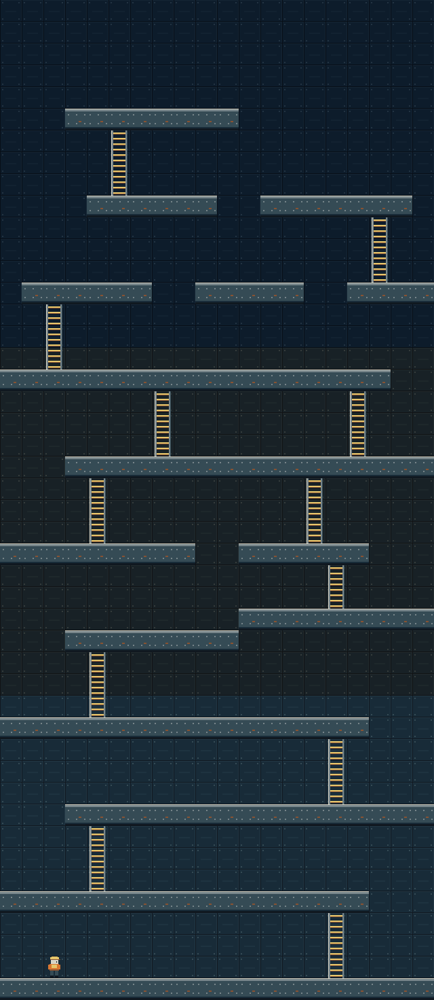

# Fase 3 — Escenario

## Objetivo
Nivel vertical único con tres zonas conectadas, construido con Tilemap y colisiones reales
(no una imagen), escaleras funcionales y cámara que sigue al jugador en vertical sin salirse del nivel.



## Archivos
| Archivo | Qué hace |
|---|---|
| `Assets/Tilemaps/LevelLayout.txt` | **Fuente del diseño del nivel** (20×46 tiles, texto editable). |
| `Assets/Editor/Phase3Builder.cs` | Valida el layout y construye `Level` en GameLevel. |
| `Assets/Scripts/Environment/CameraFollow.cs` | Seguimiento vertical suave con límites. |
| `Assets/Scripts/Environment/Ladder.cs` | Añadido `Configure(altura)` para ajustar sprite y trigger. |
| `Assets/Prefabs/Environment/Ladder.prefab` | Escalera reutilizable (trigger + sprite en mosaico). |
| `Assets/Tilemaps/Tiles/PH_Platform.asset` | Tile de plataforma (placeholder). |
| `Assets/Sprites/Placeholders/PH_WallPanel.png` | Panel de pared para los fondos (placeholder). |
| `Assets/Tests/PlayMode/GameLevelTests.cs` | 5 pruebas sobre la escena real. |

## Leyenda de `LevelLayout.txt`
La primera línea es la fila superior; 1 carácter = 1 tile de 32 px; la columna 0 está en x = −10.

| Carácter | Significado |
|---|---|
| `#` | Plataforma sólida |
| `H` | Escalera (en huecos; llega a la superficie de la plataforma de arriba) |
| `P` / `G` | Inicio del jugador / meta |
| `S` | Aparición de barriles (una por zona, se usará en la Fase 4) |
| `C` | Coleccionable (Fase 5) |
| `2` / `3` | Altura donde empieza la zona 2 / 3 |

Para cambiar el nivel: editar el texto y ejecutar **Barrel Ascent › Setup › Build Phase 3 (Level)**.
El constructor rechaza el layout si una escalera no apoya en una plataforma o no llega a otra,
si `P`, `G` o `S` flotan, o si faltan marcadores.

## Las tres zonas
| Zona | Filas (y) | Diseño |
|---|---|---|
| 1 · Base industrial | 0–14 | Plataformas anchas, un extremo abierto alternado, una escalera por piso. |
| 2 · Maquinaria | 14–30 | Escalón de 1 tile (F4), hueco de 2 tiles (F5), dos escaleras por piso. |
| 3 · La cima | 30–46 | Plataformas estrechas con huecos de 2 tiles, meta arriba (F10). |

Los extremos abiertos alternos dejan caer los barriles al piso inferior (Fase 4).
Cada zona tiene un fondo con un tinte distinto (azul, óxido, oscuro).

## Estructura en la escena
```
Level
├─ Grid (x = −10)
│  └─ Ground  Tilemap + TilemapRenderer + TilemapCollider2D (Merge)
│             + Rigidbody2D Static + CompositeCollider2D (Polygons) · capa Ground
├─ Ladders    Ladder_00…11 (prefab Ladder, capa Ladder, trigger)
├─ Bounds     Wall_Left / Wall_Right (BoxCollider2D, capa Ground)
├─ Backgrounds  Background_Zone1…3 (SpriteRenderer en mosaico, orden −20)
└─ Markers    PlayerSpawn, Goal, BarrelSpawn_Z1…Z3, ZoneStart_1…3, Collectibles/…
Player        (prefab) en PlayerSpawn
Main Camera   Camera ortográfica + PixelPerfectCamera + CameraFollow
```

## CameraFollow (Inspector)
Target = Player · Level Center X = 0 · Min Y = 0 · Max Y = 46 · Look Ahead Y = 1.5 ·
Smooth Time 0.18 · Snap To Pixel Grid activado · Pixels Per Unit 32.
`SnapToTarget()` coloca la cámara al instante (lo usará la reaparición en la Fase 5).

## Pruebas
**Automáticas** — 10/10 pasan (5 de la Fase 2 + 5 nuevas):
1. El jugador se apoya en el Tilemap y la cámara empieza abajo sin mostrar nada bajo el suelo.
2. **Las 12 escaleras** se pueden subir y dejan al jugador de pie en su plataforma.
3. **Los 5 saltos obligatorios** (escalón de F4, huecos de F5, F8 ×2 y F9) aterrizan en la plataforma destino.
4. La cámara sigue al jugador, se detiene en el límite superior con la meta a la vista y mantiene la X fija.
5. Existen las tres zonas en orden, un punto de barriles por zona y la meta en la zona 3.

Las pruebas 2 y 3 juntas demuestran que se puede ir del inicio a la meta (criterio 15).

**Manual**: abrir GameLevel, Play, y subir hasta la meta.

## Errores frecuentes
| Síntoma | Causa / solución |
|---|---|
| El jugador cae a través del suelo | El Tilemap no tiene tiles o el CompositeCollider2D está vacío: volver a ejecutar el constructor (falla si no genera colisión). |
| Se queda enganchado en las juntas | Usar CompositeCollider2D (Merge) en vez de un collider por tile. |
| La cámara tiembla o se atasca | No suavizar sobre la posición redondeada a píxel (corregido en CameraFollow). |
| Se ve fuera del nivel | Revisar Min Y / Max Y de CameraFollow. |

## Criterios de finalización
Plataformas con colisión · escaleras · tres zonas conectadas y accesibles ·
cámara vertical con límites — comprobados con pruebas automáticas.
Arte del escenario: placeholders `PH_*` hasta recibir el tileset definitivo (Fase 7).
