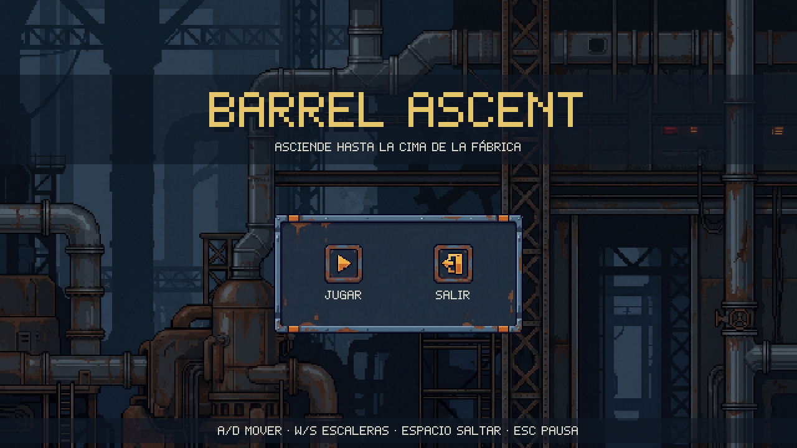
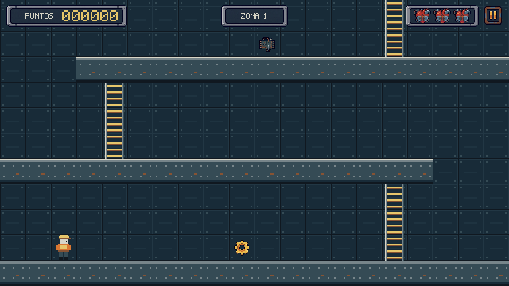
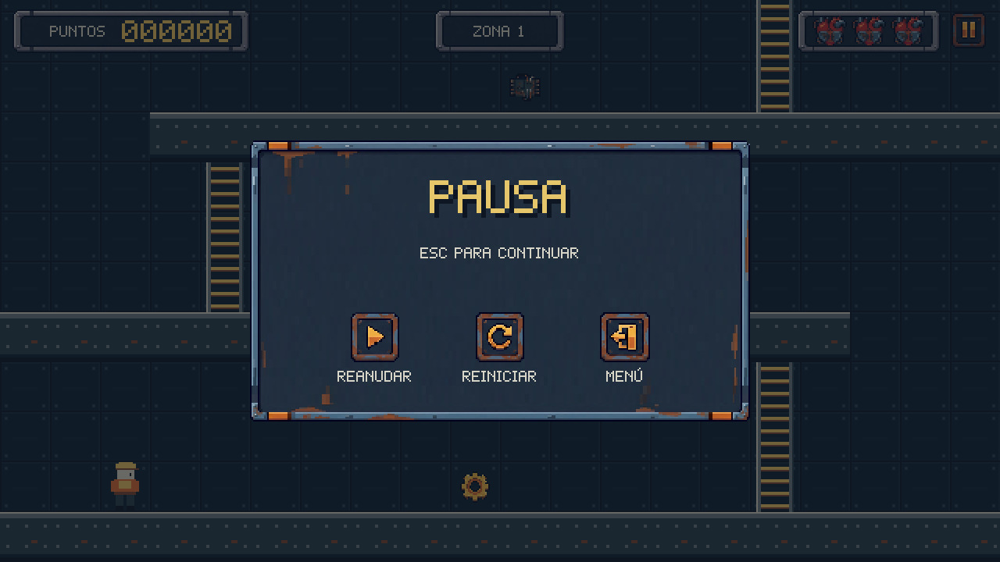
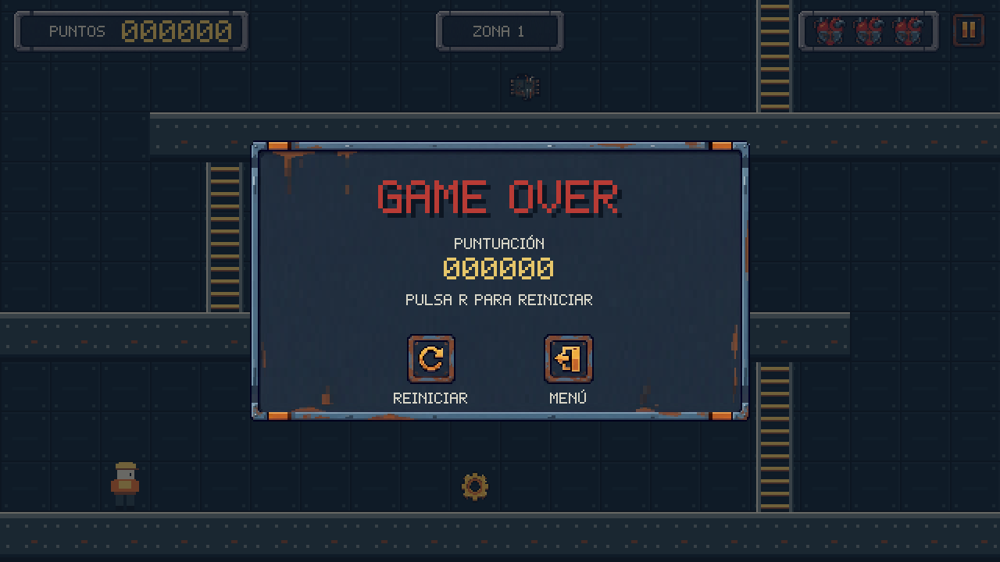
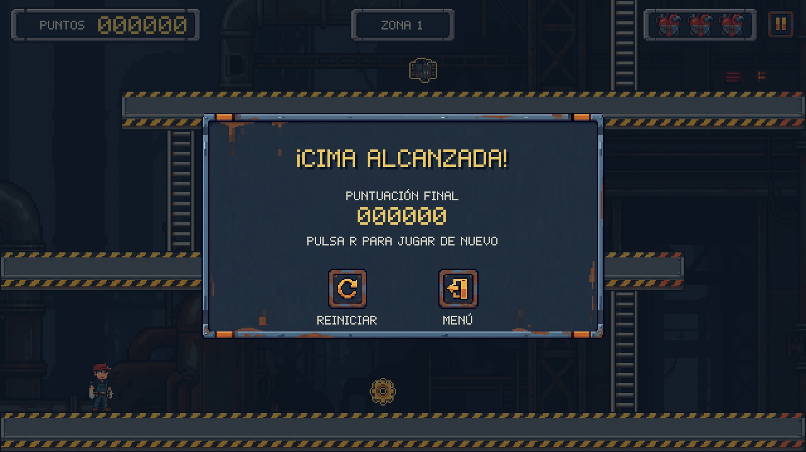

# Fase 6 — Interfaz

## Objetivo
Menú principal, HUD (puntuación, vidas, zona), aviso de cambio de zona y paneles de Pausa,
Game Over y Victoria con reinicio y vuelta al menú, con la misma estética pixel art que el juego.

| Menú principal | HUD |
|---|---|
|  |  |
| **Pausa** | **Game Over** |
|  |  |
| **Victoria** | |
|  | |

## Archivos
| Archivo | Qué hace |
|---|---|
| `Assets/Scripts/UI/UIManager.cs` | HUD, aviso de zona y paneles. Solo escucha eventos y llama a métodos públicos del GameManager. |
| `Assets/Scripts/UI/MainMenu.cs` | Jugar → GameLevel · Salir → cierra el juego. |
| `Assets/Editor/Phase6Builder.cs` | Arte de UI, escena MainMenu y UI de GameLevel. |
| `Assets/Editor/Art/PixelFontBuilder.cs` | Fuente bitmap **BarrelPixel** (5×7, con tildes y Ñ) como TMP_FontAsset. |
| `Assets/UI/Fonts/BarrelPixel.asset` | La fuente generada. |
| `Assets/UI/Sprites/*.png` | Paneles (9-slice), corazón, botones y fondo del menú (de `ArtSource/06_UI` y del fondo de la zona 1). |
| `Assets/TextMesh Pro/` | Recursos esenciales de TextMeshPro (importados del paquete). |
| `Assets/Tests/PlayMode/UITests.cs` | 6 pruebas de interfaz. |

## Decisiones
- **Fuente pixel propia**: TextMeshPro solo trae una fuente vectorial (LiberationSans) que no encaja con
  el pixel art, y el paquete de arte no incluye fuente. BarrelPixel se genera desde código (glifos
  definidos como texto) en modo bitmap. Tamaños válidos: 9, 18, 27, 36 (múltiplos de 9 = píxeles exactos).
  Se puede sustituir por otra fuente TTF en la Fase 7 si se prefiere.
- **Canvas**: Screen Space Overlay, CanvasScaler *Scale With Screen Size* 640×360, *Match = Height*,
  *Reference Pixels Per Unit* = 32 → 1 píxel de sprite = 1 píxel de referencia (×3 exacto a 1080p).
- **Entrada de UI**: EventSystem + InputSystemUIInputModule con las acciones UI por defecto del
  Input System (ratón, flechas/WASD para navegar, Enter/Espacio para pulsar). Cada panel selecciona su
  primer botón para poder usarse solo con teclado; al volver al juego se deselecciona todo para que
  Espacio (saltar) no pulse un botón.
- Textos de la interfaz en español; "GAME OVER" se mantiene como término arcade.

## Estructura
```
MainMenu:  UI (Canvas + MainMenu) ── Background · TitleBand · Title(+Shadow) · Subtitle
                                     ButtonsPanel ── PlayButton · ExitButton · HintBand · Controls
           EventSystem
GameLevel: UI (Canvas + UIManager) ── HUD ── ScorePanel · ZonePanel · LivesPanel(Heart1..3) · PauseButton · ZoneBanner
                                      PausePanel · GameOverPanel · VictoryPanel (overlay + panel + botones)
           EventSystem
```
Botones → métodos (eventos persistentes, visibles en el Inspector del Button):
Jugar → `MainMenu.Play` · Salir → `MainMenu.Exit` · Pausa (HUD) → `UIManager.OnPauseButton` ·
Reanudar → `OnResumeButton` · Reiniciar → `OnRestartButton` · Menú → `OnMainMenuButton`.

## Regenerar
1. Una sola vez (TextMeshPro): `Unity -batchmode -quit -projectPath . -importPackage "<ruta a com.unity.ugui>/Package Resources/TMP Essential Resources.unitypackage"`,
   o en el Editor: *Window › TextMeshPro › Import TMP Essential Resources*.
   (Importarlo desde un script no termina antes de salir en batchmode.)
2. **Barrel Ascent › Setup › Build Phase 6 (UI)**.
3. Capturas: **Barrel Ascent › Tools › Capture UI Screens** → `Docs/Screenshots/UI_*.png`.

## Pruebas — 6 nuevas
1. Todos los textos de ambas escenas usan BarrelPixel y la fuente tiene todos sus glifos.
2. Menú: título visible, Jugar seleccionado, Jugar carga GameLevel, Salir conectado.
3. HUD: puntuación y corazones cambian en el mismo frame que el evento.
4. ESC muestra Pausa con Reanudar seleccionado; Reanudar la oculta sin dejar botón seleccionado; el botón de pausa del HUD también pausa.
5. Game Over muestra la puntuación; Reiniciar recarga la partida (0 puntos, tiempo normal).
6. Victoria muestra la puntuación final; Menú vuelve al menú principal con el tiempo normal.

**Manual**: abrir MainMenu → Play. Probar Jugar con ratón y con Enter, ESC en partida, perder las tres vidas y llegar a la meta.

## Errores frecuentes
| Síntoma | Causa / solución |
|---|---|
| Textos en rosa o invisibles | Falta TMP Essential Resources (shader TextMeshPro/Bitmap). |
| Iconos ×3 de grandes | No usar *Set Native Size* en el editor con este Canvas; tamaño = píxeles del sprite. |
| Espacio pulsa un botón al jugar | Debe quedar `EventSystem.currentSelectedGameObject = null` al reanudar (lo hace UIManager). |
| Los botones no responden en pausa | Correcto usar tiempo no escalado: la UI de Unity ya lo usa; no depender de `Time.deltaTime`. |
| Texto borroso | Usar tamaños múltiplos de 9 y resoluciones múltiplo de 640×360. |

## Criterios de finalización
Menú principal · HUD · Pausa · Game Over · Victoria · Reinicio desde UI y con R.
Pendiente (Fase 7): personaje, tileset y fondos definitivos, efectos y audio.
