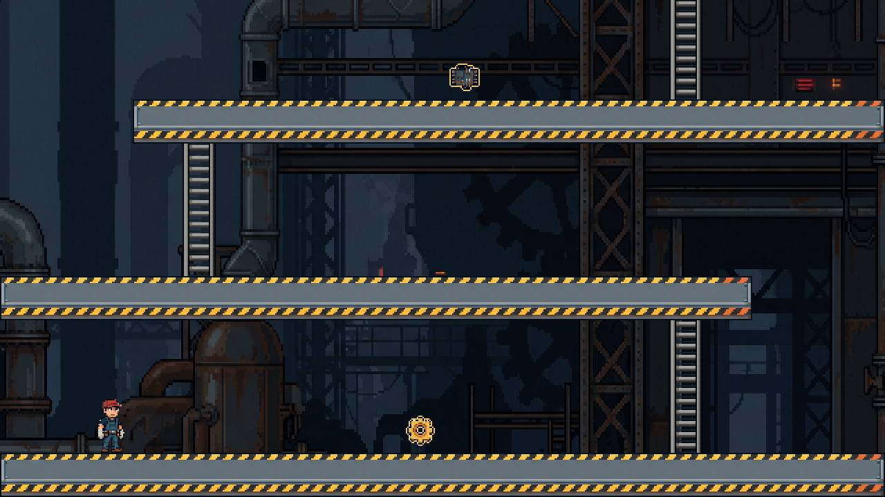
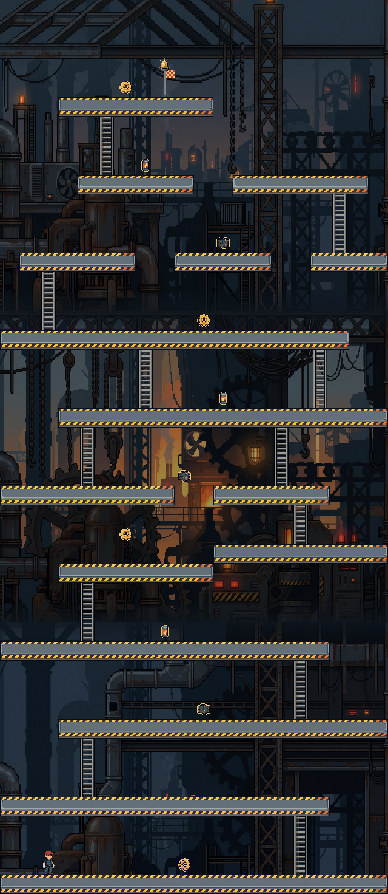

# Fase 7 — Arte y audio

## Objetivo
Sustituir los placeholders por el arte del paquete (`ArtSource/`): personaje animado, tileset,
fondos por zona, efectos y meta; dejar el sistema de audio preparado (el paquete no trae sonidos).

| Vista de juego | Nivel completo |
|---|---|
|  |  |

## Cómo se construye
```
U=/Applications/Unity/Hub/Editor/6000.4.0f1/Unity.app/Contents/MacOS/Unity
$U -batchmode -quit -projectPath . -executeMethod BarrelAscent.EditorTools.Phase7Builder.Build -logFile <log>
```
`Phase7Builder.Build` procesa el arte, ejecuta `Phase5Builder.Build` (→ 4 → 3), aplica el arte a GameLevel,
añade `EffectsManager` y `AudioManager`, y termina con `Phase6Builder.Build`. **Es ahora el punto de entrada
de toda la cadena**: si se ejecuta solo la Fase 5, el nivel vuelve a un único tile de plataforma, fondos
sin arte y sin efectos/audio.

## Archivos
| Archivo | Qué hace |
|---|---|
| `Assets/Editor/Phase7Builder.cs` | Todo el proceso de arte y el cableado de escena de esta fase. |
| `Assets/Editor/Art/SpriteExtractor.cs` | Nuevo: `FindFramesCount`, `InkBounds`, `Sample` (recorte exacto), `StripLadder`, `AddOutline`, `Place`. |
| `Assets/Scripts/Effects/SpriteEffect.cs` | Reproduce una secuencia de sprites y se desactiva (pool). |
| `Assets/Scripts/Effects/EffectsManager.cs` | Escucha eventos y lanza efectos: polvo, barril destruido, recogida, daño. |
| `Assets/Scripts/Managers/AudioManager.cs` | Música + 8 ranuras de efectos opcionales enlazadas a los eventos. |
| `Assets/Scripts/Player/PlayerController.cs` | Nuevos eventos `Jumped` / `Landed` y parámetro de Animator `Hurt` (pose de daño). |
| `Assets/Scripts/Environment/Collectible.cs` | Nuevo evento estático `AnyCollected`. |
| `Assets/Editor/Phase5Builder.cs` | Los coleccionables llevan un contorno amarillo de 1 px. |
| `Assets/Sprites/Characters/Player/` | 21 fotogramas del jugador (idle 4, run 6, jump 3, climb 4, hurt 4). |
| `Assets/Animations/Player/*.anim` | Clips Idle, Run, JumpRise, JumpFall, Climb, Hurt. |
| `Assets/Sprites/Environment/` | `platform_left/mid/right`, `ladder`, `bg_zone1..3`, `goal_beacon`. |
| `Assets/Tilemaps/Tiles/platform_*.asset` | Tiles de las tres piezas de viga (colisión de rejilla). |
| `Assets/Sprites/Effects/` | `fx_dust_*`, `fx_smash_*`, `fx_sparks_*`, `fx_impact_*`. |
| `Assets/Tests/PlayMode/ArtAudioTests.cs` | 4 pruebas nuevas (arte del jugador, efectos y sonido por evento). |

## Decisiones
- **Personaje**: escala fija 0,135 para todas las tiras (el jugador de pie mide 24×39 px ≈ 1,2 u; el collider
  sigue siendo 0,6×0,94). Cada fotograma se recorta a su tinta y se coloca en un lienzo con la **cabeza**
  centrada sobre el pivote (abajo-centro): así no "baila" al abrir las piernas. Los pies quedan en la fila 0.
  Una sola dirección de caminar (`walk_LeftToRight`) + `flipX`, como ya hacía el controlador.
- **Trepar**: las tiras de trepar traen la escalera dibujada. `StripLadder` quita largueros (columnas casi
  llenas en los bordes), peldaños grises conectados y contornos sueltos; los guantes (gris cálido) y el mono
  se conservan. Así la escalera del nivel no "resbala" con el jugador.
- **Animator**: se rehace la máquina de estados del mismo asset (no cambia el GUID): Idle, Run, Jump (blend
  1D por `VelocityY`: brazos arriba al subir, piernas recogidas al caer), Climb (velocidad = `ClimbSpeed`,
  así se detiene si el jugador no se mueve en la escalera) y Hurt (nuevo bool `Hurt`, 0,4 s tras un golpe).
- **Tileset**: la viga con franjas de advertencia se corta en tres piezas de 180×187 px de origen (3 periodos
  de franja, 60 px) → 32×32. El builder elige extremo izquierdo / tramo / extremo derecho según los vecinos
  de cada celda. Todas usan colisión de rejilla: el CompositeCollider2D es idéntico.
- **Escalera**: un peldaño de la escalera del tileset remuestreado a 24×8 sin el fondo azul entre largueros,
  apilado 4 veces → tile de 32×32 que se repite sin costuras.
- **Fondos**: cada JPG se reduce a la altura de su zona (16–18 tiles → 512–576 px) en 16:9, se oscurece
  (×0,8; ×0,62 en la zona 2, cuyo resplandor naranja tapaba los barriles) y se funde a sombra en los
  40 px superiores e inferiores para que el cambio de zona no sea un corte.
- **Efectos**: polvo al saltar y al aterrizar (caída > 3 u/s), destello + astillas al pisar un barril
  (se omiten los fotogramas con el barril entero, que ya dibuja el propio barril), chispas al recoger e
  impacto al recibir daño. Pool de 8 objetos que crece si hace falta; se congelan con la pausa.
- **Audio**: no hay sonidos en el paquete y no se ha descargado nada. `AudioManager` tiene ranuras para
  música, salto, aterrizaje, barril, recogida, daño, zona completada, victoria y game over; con la ranura
  vacía simplemente no suena. La música se pausa con la pausa y se detiene al ganar/perder.
- **Meta**: no hay bandera en el paquete; se mantiene el mástil y la bandera a cuadros dibujados y se
  remata con la **baliza amarilla** de `factory_decorations.png`, visible desde lejos.
- **Coleccionables**: contorno amarillo de 1 px en los tres (el "componente" gris no se veía en la zona 3).

## Pendiente / no usado
- `character_GoingDown` (bajar de espaldas) no se usa: el Animator solo recibe `ClimbSpeed` sin signo.
- `jump` fotograma 0 (agacharse) y `damage` fotogramas 1–3 (volteretas) no se usan.
- `factory_decorations.png` (tuberías, lámparas, máquinas) solo aporta la baliza; los fondos ya son densos.

## Pruebas
37/37 PlayMode (33 anteriores + 4 de `ArtAudioTests`).
