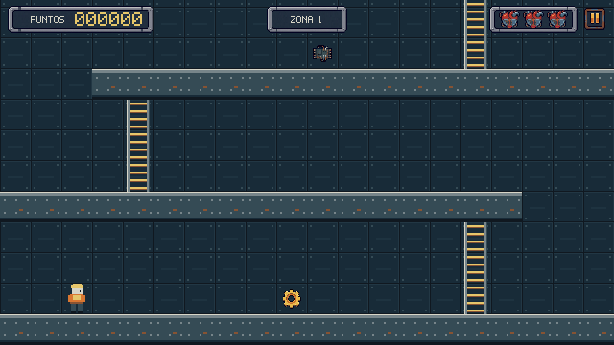
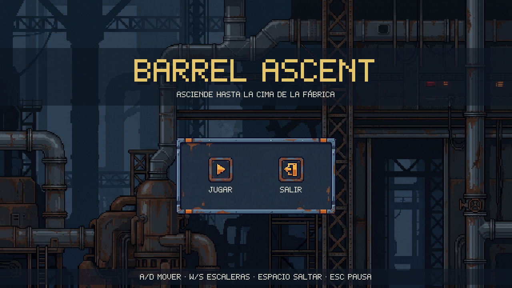
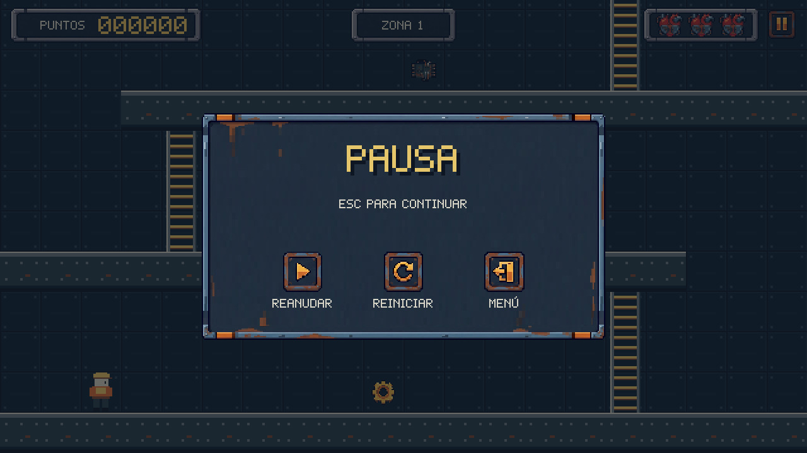
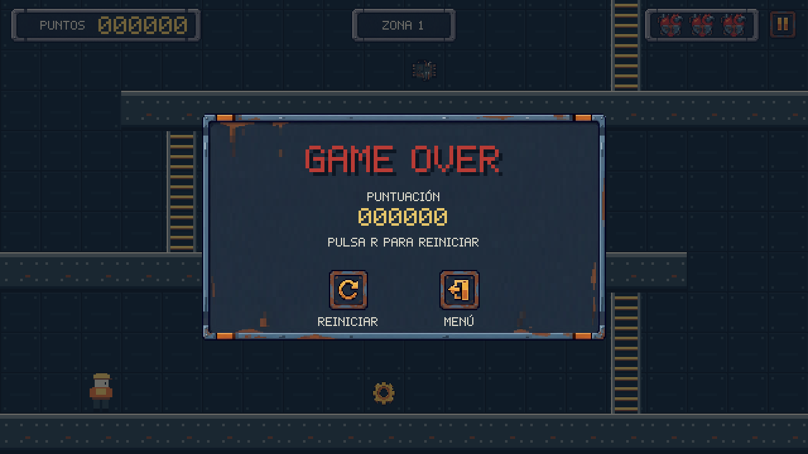
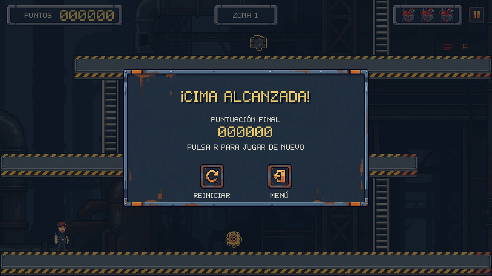
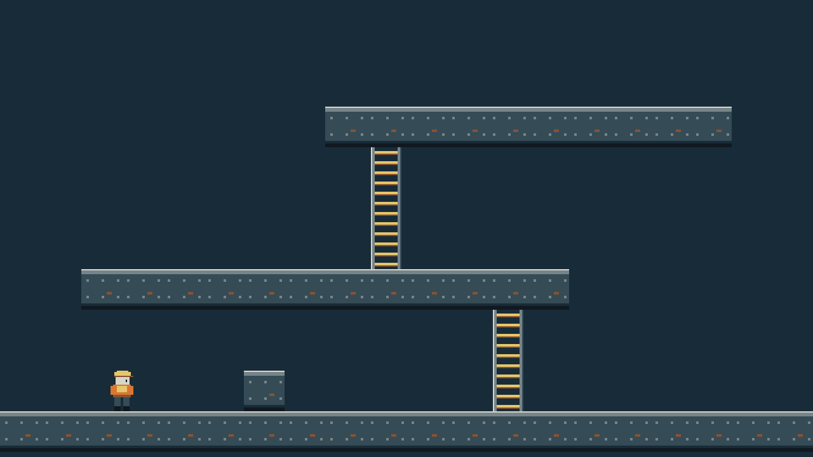
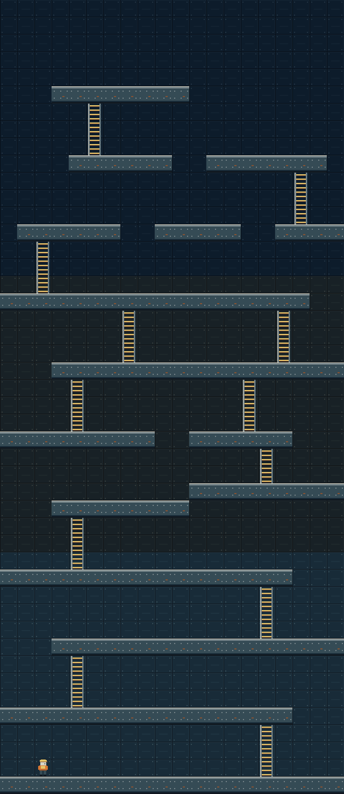

# Barrel Ascent

Juego de plataformas 2D en pixel art hecho en Unity 6 (C#) para el examen de crédito de la
materia Laboratorio de Videojuegos. Es una partida corta (3 a 5 minutos) en un único nivel
vertical: hay que subir una fábrica piso a piso mientras los barriles bajan rodando en zigzag.

> Sube, esquiva y pisa: la fábrica entera rueda contra ti.



## Premisa

Una antigua fábrica de barriles se encendió sola durante la noche. La línea automática de la
azotea suelta barriles sin parar y los deja caer por todos los pisos. La técnica de mantenimiento
de turno es la única persona dentro del edificio, y la única forma de detener la línea es activar
la **baliza de emergencia** de la cima. Para llegar tiene que cruzar tres zonas (Base industrial,
Maquinaria y La cima) y, de paso, recoger las piezas de repuesto que encuentre.

## Capturas

| Menú principal | Pausa |
| --- | --- |
|  |  |

| Game Over | Victoria |
| --- | --- |
|  |  |

| Vista del juego | Nivel completo (zonas 1, 2 y 3 de abajo arriba) |
| --- | --- |
|  |  |

## Ejecutar el juego (macOS)

El build es una aplicación universal para Mac (Intel y Apple silicon): `Barrel Ascent.app`.
No forma parte del repositorio (la carpeta `Builds/` está en `.gitignore`), así que se entrega
aparte o se genera desde el proyecto (ver [Generar el build](#generar-el-build-de-macos)).

1. Si lo recibes comprimido, descomprime el `.zip` y deja `Barrel Ascent.app` en cualquier carpeta
   (por ejemplo, Aplicaciones).
2. La primera vez, **haz clic derecho sobre `Barrel Ascent.app` y elige Abrir**, y luego confirma
   con **Abrir** en el diálogo. La app no está firmada por un desarrollador identificado de Apple,
   así que Gatekeeper bloquea el doble clic normal la primera vez. Después ya se abre con doble clic.
3. Si macOS sigue sin dejar abrirla, ve a *Ajustes del Sistema > Privacidad y seguridad* y pulsa
   **Abrir igualmente** junto al aviso de Barrel Ascent.

El juego arranca a pantalla completa. Al salir de la pantalla completa queda en una ventana 16:9
redimensionable de 1280×720.

Para compartir el build sin estropear el paquete `.app`, comprímelo con:

```bash
ditto -c -k --keepParent "Builds/macOS/Barrel Ascent.app" "Builds/BarrelAscent-macOS.zip"
```

## Abrir el proyecto en Unity

1. Instala **Unity 6000.4.0f1** desde Unity Hub (con el módulo *Mac Build Support (Mono)* si vas a
   generar el build).
2. En Unity Hub: *Add > Add project from disk* y elige la carpeta del repositorio.
3. Abre la escena `Assets/Scenes/MainMenu/MainMenu.unity` y pulsa Play. El juego también se puede
   probar directamente desde `Assets/Scenes/GameLevel/GameLevel.unity`.

Los paquetes se resuelven solos al abrir el proyecto (ver [Tecnologías](#tecnologías-y-paquetes)).

## Cómo jugar

**Objetivo:** llegar a la cima de la fábrica y tocar la baliza de emergencia antes de perder las
tres vidas, sumando la mayor puntuación posible.

### Controles

| Acción | Teclado |
| --- | --- |
| Moverse | A / D o flechas izquierda / derecha |
| Subir / bajar escalera | W / S o flechas arriba / abajo |
| Saltar | Espacio |
| Pausa / reanudar | Esc (o el botón de pausa del HUD) |
| Reiniciar | R (solo tras la victoria o el Game Over) |
| Menús | Ratón, o flechas + Enter / Espacio |

### Reglas

- Se empieza con **3 vidas** (los corazones del HUD).
- **Golpe de barril:** tocar un barril de lado quita 1 vida, empuja al jugador hacia atrás y da
  **1,5 s de invulnerabilidad** (el personaje parpadea y no puede recibir más daño).
- **Caída:** caer por debajo del nivel quita 1 vida y el jugador reaparece en el punto seguro de la
  zona más alta que haya alcanzado, también con invulnerabilidad.
- **Pisotón:** caer encima de un barril lo destruye y hace rebotar al jugador, sin daño.
- Solo hay un salto por contacto con el suelo (no hay doble salto). En la escalera no se puede
  saltar ni moverse de lado.
- **Victoria:** tocar la baliza de la cima.
- **Derrota (Game Over):** perder la tercera vida.
- **Pausa:** Esc congela la partida y muestra el panel con *Reanudar*, *Reiniciar* y *Menú*.
- **Reinicio:** desde los botones de los paneles o con la tecla R una vez terminada la partida;
  vuelve a cargar el nivel desde cero.

### Puntuación

| Acción | Puntos |
| --- | --- |
| Recoger un coleccionable (10 en el nivel, una vez cada uno) | +100 |
| Destruir un barril pisándolo | +50 |
| Entrar por primera vez en la zona siguiente | +250 |
| Tocar la baliza de la meta (completa la zona 3 y da el bonus de cima) | +250 +1000 |

Los puntos solo cuentan durante la partida activa (no en pausa ni después de terminar). Sin pisar
barriles, el máximo es 2750 puntos.

### Las tres zonas

Cada zona tiene su fondo y su propio generador de barriles, activo solo mientras el jugador está en
ella. Hay como máximo 6 barriles a la vez por zona.

| Zona | Diseño | Barriles |
| --- | --- | --- |
| 1. Base industrial | Vigas anchas con un extremo abierto alterno; una escalera por piso. | 2 u/s, uno cada 4 s |
| 2. Maquinaria | Escalones de un tile, huecos de dos tiles y dos escaleras por piso. | 2,75 u/s, uno cada 3 s |
| 3. La cima | Vigas estrechas con huecos de dos tiles; la baliza en el último piso. | 3,5 u/s, uno cada 2 s |

Los valores de dificultad se editan sin tocar código en `Assets/Settings/Zones/Zone1..3.asset`.

## Estructura del proyecto

```
Assets/
  Scripts/            Código del juego (ensamblado BarrelAscent)
    Player/           PlayerController, PlayerCollision
    Enemies/          BarrelController, BarrelSpawner
    Environment/      CameraFollow, Ladder, Collectible, Goal, ZoneConfig
    Managers/         GameManager, LevelManager, AudioManager
    UI/               UIManager, MainMenu
    Effects/          EffectsManager, SpriteEffect
  Editor/             Constructores de escenas, build y herramientas de arte
    Art/              SpriteExtractor, PixelFontBuilder
  Tests/
    EditMode/         Comprobaciones del proyecto
    PlayMode/         Pruebas de juego
  Scenes/             MainMenu, GameLevel
  Prefabs/            Jugador, barril, coleccionables y meta
  Settings/           Input Actions, ZoneConfig de cada zona
  Sprites/ Tilemaps/ UI/ Animations/ Audio/
ArtSource/            Imágenes originales del arte, antes de procesarlas
Docs/                 Documentación por fase, capturas y entregables
```

### Scripts principales

| Script | Qué hace |
| --- | --- |
| `PlayerController` | Movimiento, salto con *coyote time* y *jump buffer* (`TryJump`), escaleras y Animator. |
| `PlayerCollision` | Contacto con barriles: pisotón y rebote, o daño, retroceso e invulnerabilidad. |
| `BarrelController` | Máquina de estados del barril (aparece, rueda, cae, destruido) en `FixedUpdate`. |
| `BarrelSpawner` | Genera barriles de una zona según su `ZoneConfig`. |
| `CameraFollow` | Seguimiento vertical suave con límites y ajuste a la rejilla de píxeles (`LateUpdate`). |
| `GameManager` | Puntuación, vidas, pausa, victoria, derrota y reinicio; publica eventos. |
| `LevelManager` | Zona actual, spawner activo, bonus por zona, punto de reaparición y meta. |
| `UIManager` | HUD, aviso de zona y paneles; solo escucha eventos y llama al GameManager. |
| `AudioManager` / `EffectsManager` | Sonido y efectos visuales a partir de los eventos del juego. |

## Reconstruir las escenas

Las escenas, prefabs y assets procesados se generan con constructores de editor que se pueden
volver a ejecutar, desde el menú **Barrel Ascent > Setup** de Unity o en batchmode.
`Phase7Builder.Build` ejecuta la cadena completa: arte, nivel, jugador, barriles, reglas, efectos,
audio e interfaz.

```bash
U=/Applications/Unity/Hub/Editor/6000.4.0f1/Unity.app/Contents/MacOS/Unity
```

```bash
$U -batchmode -quit -projectPath . -executeMethod BarrelAscent.EditorTools.Phase7Builder.Build -logFile build_scenes.log
```

Las capturas de `Docs/Screenshots/` se regeneran con *Barrel Ascent > Tools* (`ScenePreview`).
Batchmode no funciona si el proyecto está abierto en el editor de Unity: ciérralo antes.

## Generar el build de macOS

Desde el menú **Barrel Ascent > Build > macOS**, o:

```bash
$U -batchmode -quit -projectPath . -executeMethod BarrelAscent.EditorTools.BuildScript.BuildMacOS -logFile build_macos.log
```

El resultado queda en `Builds/macOS/Barrel Ascent.app`.

## Pruebas

Hay 45 pruebas automáticas (4 EditMode y 41 PlayMode) con Unity Test Framework. Se ejecutan desde
*Window > General > Test Runner* o en batchmode:

```bash
$U -batchmode -projectPath . -runTests -testPlatform EditMode -testResults editmode.xml -logFile editmode.log
```

```bash
$U -batchmode -projectPath . -runTests -testPlatform PlayMode -testResults playmode.xml -logFile playmode.log
```

Las pruebas PlayMode tardan unos 3 minutos. Cubren el movimiento y el salto, las escaleras, el
comportamiento de los barriles, la accesibilidad de todo el nivel, las reglas de puntuación y vidas,
la interfaz, el arte y el audio conectados, una partida completa de principio a fin y una prueba de
resistencia de 60 s con barriles.

## Tecnologías y paquetes

- **Unity 6000.4.0f1**, C#, Built-in Render Pipeline, cámara ortográfica.
- Resolución de referencia 640×360, 32 píxeles por unidad, tiles de 32 px.
- **Input System** 1.19 (acciones del proyecto en `Assets/Settings/BarrelAscentControls.inputactions`).
- **2D feature set**: Sprites, Tilemap, 2D Pixel Perfect y física 2D.
- **uGUI** 2.0 con **TextMeshPro** y una fuente pixel propia (`BarrelPixel`).
- **Unity Test Framework** 1.6.

## Créditos y recursos de terceros

- **Arte:** creado con la IA generativa **Gemini** de Google (imágenes originales en `ArtSource/`)
  y procesado en el proyecto a pixel art real de 32 PPU con `SpriteExtractor`.
- **Música y efectos de sonido:** [Pixabay](https://pixabay.com/), bajo su licencia de contenido.
- **Motor y paquetes:** [Unity](https://unity.com/) y los paquetes oficiales de Unity listados arriba.
- La fuente pixel `BarrelPixel`, el diseño del nivel y todo el código son propios del proyecto.

## Entregables

En `Docs/Entregables/` están los documentos finales del proyecto, ya terminados:

- `GDD_BarrelAscent.pdf` (y su fuente `.tex`): documento de diseño del juego.
- `Reporte_Tecnico_BarrelAscent.pdf` (y su fuente `.tex`): reporte técnico en formato LNCS.

## Autora

**Ashley Peña Nolasco**, ID 178226.
